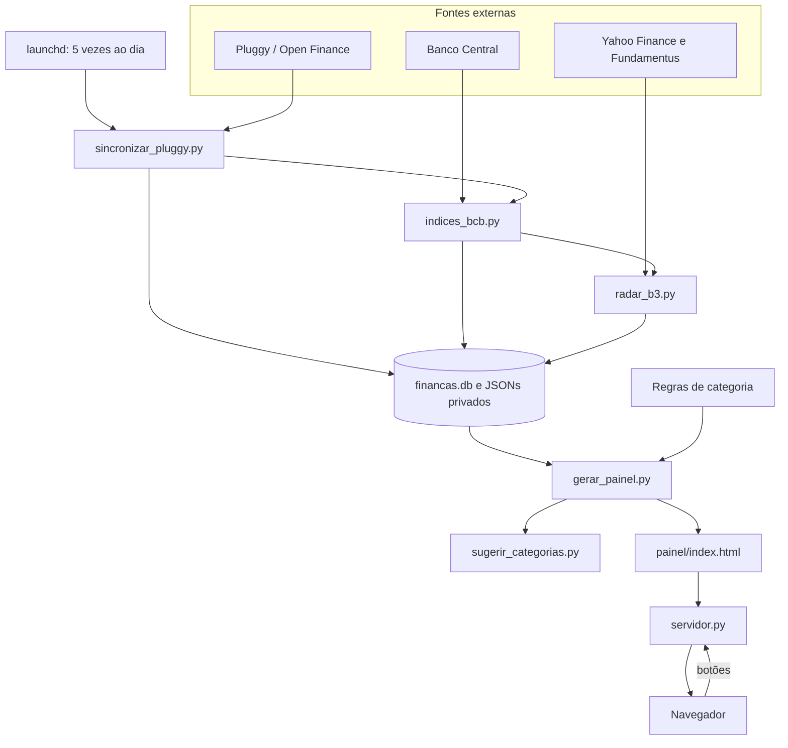
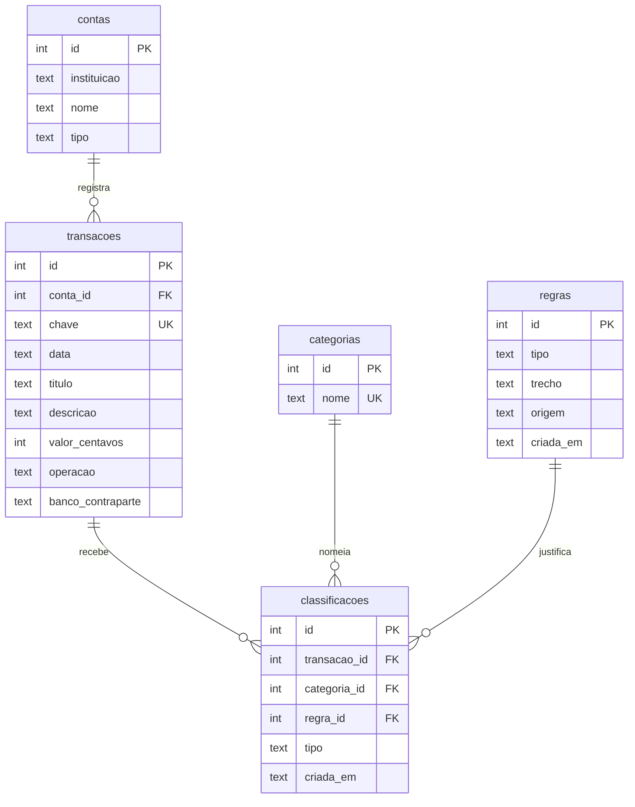

# Arquitetura

Painel de finanças pessoais que reúne conta corrente e corretora, roda no computador do dono e se atualiza sozinho. Este documento registra as características que guiam o projeto e cada decisão de arquitetura, no formato de ADR (*Architecture Decision Record*).

## Visão geral

## Características de arquitetura

### Restrição: privacidade

Extrato bancário e nomes de terceiros não saem do controle do dono. Isso não entra na disputa do top 3 porque não é negociável: é uma condição que toda decisão precisa cumprir ([ADR-001](#adr-001-processar-e-guardar-os-dados-só-no-computador-do-dono)).

### Top 3

| # | Característica | O que significa aqui | Por que está no top 3 |
|---|---|---|---|
| 1 | **Confiabilidade** | O número mostrado está certo, e uma falha não perde nem corrompe dados | Um painel financeiro com número errado é pior do que não ter painel |
| 2 | **Auditabilidade** | Dá para explicar de onde veio cada número | Categorias e receitas influenciam decisões; o dono precisa poder contestar cada uma |
| 3 | **Testabilidade** | Cada regra pode ser verificada de forma automática e isolada | As regras mudam com frequência e lidam com dados que não podem ir para o repositório |

**Manutenibilidade ficou de fora do top 3.** Ela importa, mas o sistema é pequeno e tem um único desenvolvedor, e boa parte dela já vem da testabilidade e da divisão em módulos ([ADR-005](#adr-005-dividir-o-código-em-módulos-por-responsabilidade)).

**Disponibilidade foi sacrificada de propósito:** com o computador desligado, o painel fica fora do ar. É o preço da restrição de privacidade.

### Como cada característica é medida

| Característica | Verificação | Situação atual |
|---|---|---|
| Confiabilidade | Testes de falha: rede fora, API instável, um banco caindo, execuções simultâneas, erro no meio da gravação | Automática, a cada push |
| Confiabilidade | Comparar o cálculo próprio com uma fonte externa | 115,99% do CDI calculado contra 116,02% do portal da corretora |
| Confiabilidade | Comparar antes e depois de migrações | Lançamentos idênticos nas duas migrações do banco; soma em centavos conferida |
| Auditabilidade | Ajustes manuais marcados e sugestões que não alteram dados sem confirmação | Coberto por testes |
| Auditabilidade | Cada lançamento aponta para a regra que o classificou | 100% das transações, por chave estrangeira |
| Testabilidade | Tempo e isolamento da suíte | Mais de 300 testes em cerca de 1 segundo, sem rede e sem dados reais |
| Testabilidade | Injeção manual de bugs para validar os testes | 50 bugs injetados, 50 detectados depois de completar um teste que faltava |

### Lacunas conhecidas

- **Auditabilidade:** as regras pessoais ficam num arquivo sem histórico próprio: o banco registra quando uma regra foi usada ou confirmada, mas não as edições feitas à mão.
- **Auditabilidade:** um lançamento que o banco de origem reescreve (por exemplo, uma descrição que muda) entra como novo, e o histórico do anterior é apagado com ele.
- **Auditabilidade:** os ajustes manuais ainda ficam em JSON, fora do banco.
- **Testabilidade:** o JavaScript do painel e os formatos reais das APIs externas não têm testes automatizados.
- **Manutenibilidade:** `gerar_painel.py` mistura classificação, cálculos e montagem da página.

## Registro de decisões

| ADR | Decisão | Status | Características |
|---|---|---|---|
| [001](#adr-001-processar-e-guardar-os-dados-só-no-computador-do-dono) | Dados só no computador do dono | Aceita | Privacidade |
| [002](#adr-002-coletar-o-extrato-pelo-navegador) | Coletar pelo navegador | Substituída pela 003 | Confiabilidade |
| [003](#adr-003-sincronizar-por-open-finance-com-a-pluggy) | Open Finance com a Pluggy | Aceita | Confiabilidade |
| [004](#adr-004-gerar-uma-página-única-com-os-dados-embutidos) | Página única gerada | Aceita | Testabilidade |
| [005](#adr-005-dividir-o-código-em-módulos-por-responsabilidade) | Módulos por responsabilidade | Aceita | Manutenibilidade, testabilidade |
| [006](#adr-006-usar-só-a-biblioteca-padrão-do-python-em-produção) | Só biblioteca padrão | Aceita | Confiabilidade |
| [007](#adr-007-guardar-as-transações-em-sqlite) | Transações em SQLite | Aceita | Confiabilidade |
| [008](#adr-008-categorizar-por-regras-explícitas-e-ordenadas) | Regras explícitas e ordenadas | Aceita | Auditabilidade |
| [009](#adr-009-conciliar-transferências-entre-bancos) | Conciliação entre bancos | Aceita | Confiabilidade |
| [010](#adr-010-tratar-dinheiro-de-terceiros-como-neutro-e-marcar-ajustes-manuais) | Neutros e ajustes marcados | Aceita | Auditabilidade |
| [011](#adr-011-o-modelo-de-categorias-só-sugere) | Modelo só sugere | Aceita | Auditabilidade |
| [012](#adr-012-recalcular-a-rentabilidade-com-dados-oficiais) | Rentabilidade com dados oficiais | Aceita | Confiabilidade, auditabilidade |
| [013](#adr-013-tornar-a-sincronização-tolerante-a-falhas) | Sincronização tolerante a falhas | Aceita | Confiabilidade |
| [014](#adr-014-combinar-fontes-gratuitas-de-dados-de-mercado) | Fontes gratuitas de mercado | Aceita | Confiabilidade |
| [015](#adr-015-expor-as-ações-por-um-servidor-restrito-ao-próprio-computador) | Servidor restrito ao computador | Aceita | Privacidade |
| [016](#adr-016-rodar-como-serviço-do-sistema-operacional) | Serviço do sistema operacional | Aceita | Confiabilidade |
| [017](#adr-017-publicar-uma-demonstração-sem-acesso-aos-dados-reais) | Demo sem dados reais | Aceita | Privacidade, testabilidade |
| [018](#adr-018-isolar-os-testes-e-rodá-los-em-integração-contínua) | Testes isolados e CI | Aceita | Testabilidade |
| [019](#adr-019-analisar-ações-como-pesquisa-sem-recomendação) | Análise sem recomendação | Aceita | Auditabilidade |
| [020](#adr-020-modelar-o-banco-com-classificações-rastreáveis) | Banco modelado e rastreável | Aceita | Auditabilidade, confiabilidade |

---

### ADR-001: Processar e guardar os dados só no computador do dono

**Status:** Aceita · 2026-10

**Contexto.** O sistema lida com extrato bancário, saldos e nomes de terceiros. Um vazamento teria consequências reais, e o único usuário é o próprio dono.

**Decisão.** Dados e credenciais ficam em `dados/` e `.env`, fora do Git. O processamento acontece no computador do dono, e o repositório contém só código e regras genéricas.

**Alternativas.**
- *Cloudflare Pages com login:* acessível de qualquer lugar, mas guarda o extrato com terceiros e não executa os botões.
- *Servidor na nuvem:* disponível o tempo todo, mas coloca credenciais bancárias num servidor a ser mantido e protegido.

**Consequências.**
- (+) Não há servidor público para invadir, nem custo mensal.
- (−) Com o computador desligado, não há painel nem sincronização.

---

### ADR-002: Coletar o extrato pelo navegador

**Status:** Substituída pela [ADR-003](#adr-003-sincronizar-por-open-finance-com-a-pluggy) · 2026-10

**Contexto.** O banco não oferece API para pessoa física, e o primeiro objetivo era validar o painel com o histórico completo.

**Decisão.** Ler os dados das telas do banco e da corretora numa sessão autenticada pelo dono, apenas para visualização.

**Consequências.**
- (+) Trouxe o histórico completo desde a abertura da conta, que o Open Finance não alcança.
- (−) Exigia login manual a cada coleta e quebraria com qualquer mudança nas telas.

---

### ADR-003: Sincronizar por Open Finance com a Pluggy

**Status:** Aceita · 2026-10

**Contexto.** A coleta manual não permitia atualização automática.

**Decisão.** Conectar os bancos pelo plano gratuito do Meu Pluggy e ler os dados pela API dele. O histórico anterior aos 12 meses cobertos permanece no banco local.

**Alternativas.**
- *Baixar extrato em CSV todo mês:* simples, mas continua manual e não cobre investimentos.
- *Automatizar o navegador:* frágil, e o login exige QR Code no celular.

**Consequências.**
- (+) Banco e corretora chegam por uma única API, com dados estruturados como o banco de origem de cada Pix.
- (−) A atualização acontece uma vez por dia, sem como forçar, então o painel fica de 1 a 2 dias atrás do banco.
- (−) O consentimento vence em até 12 meses, e o rendimento de alguns CDBs chega com atraso.

---

### ADR-004: Gerar uma página única com os dados embutidos

**Status:** Aceita · 2026-10

**Contexto.** O painel precisa funcionar como arquivo, por servidor local e como página publicada, sem etapa de build.

**Decisão.** `gerar_painel.py` monta um único `index.html` com dados, estilo e JavaScript embutidos. Filtros e gráficos rodam no navegador.

**Alternativas.**
- *Front-end que consulta uma API a cada filtro:* mais flexível, mas exigiria servidor sempre ativo e uma camada de API.
- *React ou similar:* adicionaria build e dependências sem resolver um problema real neste tamanho.

**Consequências.**
- (+) A mesma página serve o painel real e a demo.
- (+) Cada geração é uma função pura dos dados, simples de testar.
- (−) O arquivo cresce com o histórico, e os dados só mudam quando a página é gerada de novo.

---

### ADR-005: Dividir o código em módulos por responsabilidade

**Status:** Aceita · 2026-11

**Contexto.** O projeto cresceu de um script para várias integrações, e o front-end chegou a mais de 1.000 linhas num único arquivo.

**Decisão.** Um módulo Python por responsabilidade, em `scripts/`, com dependências em uma só direção. O front-end fica em `base.html`, `estilo.css` e `app.js`, reunidos na geração da página.

| Papel | Módulos |
|---|---|
| Pontos de entrada | `servidor.py`, `sincronizar_pluggy.py`, `gerar_demo.py` |
| Regras e geração | `gerar_painel.py`, `sugerir_categorias.py` |
| Persistência | `base_dados.py`, `importar_extrato.py` |
| Integrações externas | `indices_bcb.py`, `radar_b3.py` |

**Alternativas.**
- *Pacote Python com subpastas:* organização mais convencional, mas os serviços instalados e a skill de análise dependem dos caminhos atuais, e o ganho seria pequeno neste tamanho.

**Consequências.**
- (+) Cada módulo pode ser testado separadamente, e as integrações podem ser simuladas nos testes.
- (−) `gerar_painel.py` ainda acumula classificação, cálculos e montagem da página.
- (−) `sincronizar_pluggy.py` mistura o acesso à API com regras de atualização das posições.

---

### ADR-006: Usar só a biblioteca padrão do Python em produção

**Status:** Aceita · 2026-10

**Contexto.** Os scripts rodam sozinhos, agendados pelo sistema operacional. Uma dependência quebrada falharia sem ninguém olhando.

**Decisão.** Produção usa só a biblioteca padrão. `pytest` e `ruff` são ferramentas de desenvolvimento.

**Consequências.**
- (+) Nada para instalar ou atualizar nos serviços, e menor exposição a pacotes de terceiros.
- (−) Mais código próprio para HTTP, servidor e o classificador.

---

### ADR-007: Guardar as transações em SQLite

**Status:** Aceita · 2026-11 · Substitui o arquivo de texto `.psv` · Complementada pela [ADR-020](#adr-020-modelar-o-banco-com-classificações-rastreáveis)

**Contexto.** A sincronização troca o período recente várias vezes ao dia. Reescrever um arquivo de texto poderia deixar o histórico pela metade numa falha.

**Decisão.** As transações ficam em `dados/financas.db`. A troca de período acontece numa única transação do banco. Posições e regras continuam em JSON.

**Alternativas.**
- *PostgreSQL:* exigiria um servidor para um único usuário.
- *Manter o texto com cópia de segurança:* protege menos e exige restauração manual.

**Consequências.**
- (+) Ou o período inteiro entra, ou nada muda, e o SQLite já vem com o Python.
- (−) O banco não é legível num editor de texto.
- (−) Os dados ficam em dois formatos, SQLite e JSON.

---

### ADR-008: Categorizar por regras explícitas e ordenadas

**Status:** Aceita · 2026-10

**Contexto.** Cada lançamento precisa de uma categoria, e o dono precisa entender e corrigir o resultado.

**Decisão.** Uma sequência fixa em que a primeira regra que bater decide. Regras de estabelecimento são versionadas; regras sobre pessoas ficam em arquivo privado.

**Consequências.**
- (+) Resultado previsível, explicável e fácil de testar.
- (+) A fatia sem categoria caiu de 74,5% para menos de 6%.
- (−) Exige manutenção manual e não reconhece estabelecimentos novos.

---

### ADR-009: Conciliar transferências entre bancos

**Status:** Aceita · 2026-10

**Contexto.** Um Pix para o próprio nome pode ser investimento ou apenas movimentação entre contas. Tratar todos como investimento gerou números errados.

**Decisão.** Só conta como aporte o Pix que também aparece na corretora, com mesma data e valor. Cada registro da corretora é consumido uma única vez. O código do banco de destino separa as demais contas próprias.

**Consequências.**
- (+) Investimentos e transferências ficam corretos, inclusive com dois Pix iguais no mesmo dia.
- (−) Depende de dados das duas pontas, e o histórico antigo não tem o código do banco.

---

### ADR-010: Tratar dinheiro de terceiros como neutro e marcar ajustes manuais

**Status:** Aceita · 2026-11

**Contexto.** Parte do dinheiro que passa pela conta não é renda do dono, e parte da renda não corresponde a um lançamento específico.

**Decisão.** Regras privadas marcam movimentações neutras por descrição, período e banco. Valores que o extrato não mostra entram como lançamentos identificados como "Ajuste manual".

**Consequências.**
- (+) Entradas e saídas refletem a realidade, e o lançamento original continua visível.
- (−) São regras específicas, mantidas à mão.

---

### ADR-011: O modelo de categorias só sugere

**Status:** Aceita · 2026-11

**Contexto.** Avaliado em estabelecimentos que nunca viu, o classificador local acerta cerca de 97% com confiança acima de 80%, mas responde só cerca de metade dos casos. O conjunto é pequeno e os nomes reais sem categoria costumam ser intermediadores de pagamento.

**Decisão.** Um Naive Bayes local sugere categorias numa tela de revisão. Só vira regra quando o dono confirma.

**Alternativas.**
- *Aplicar sozinho acima de um limiar:* reduziria "Outros" sem revisão, mas erros passariam despercebidos.

**Consequências.**
- (+) Nenhum dado sai do computador, e nenhuma categoria muda sem confirmação.
- (+) Cada confirmação vira exemplo para o próximo treino.
- (−) O modelo só conhece o texto do nome: não sabe o que uma marca vende.
- (−) A "confiança" do Naive Bayes não é uma probabilidade real; o que vale é a precisão medida na validação.

**Ajustes avaliados.** Cada mudança foi medida isoladamente, com a validação cruzada de 5 partes, sobre cerca de 200 estabelecimentos. Referência: precisão de 93,6% e cobertura de 61,6%, com confiança acima de 80%.

| Mudança | Resultado | Decisão |
|---|---|---|
| Remover a cidade do fim das compras | Precisão de 97,3%, cobertura de 54,2% | Aplicada |
| Incluir Apostas no treino | Precisão igual, cobertura −1,5 ponto; a categoria deixa de ser impossível | Aplicada |
| Parar de contar palavra e prefixo em dobro | Acerto geral caiu de 66,0% para 60,6%, com a cidade já removida | Rejeitada |
| Peso inicial igual para as categorias | No mesmo nível de precisão, a cobertura ficou igual; só mudou a escala da confiança | Rejeitada |
| Exigir palavra conhecida na categoria vencedora | Sem efeito acima do limiar usado | Rejeitada |

Com as duas aplicadas: precisão de 97,2% e cobertura de 51,9%.

---

### ADR-012: Recalcular a rentabilidade com dados oficiais

**Status:** Aceita · 2026-10

**Contexto.** O Open Finance não entrega a rentabilidade histórica calculada pela corretora.

**Decisão.** Usar o CDI diário e o IPCA do Banco Central e compor a rentabilidade mês a mês. Enquanto só houver meses do portal, ficam os números oficiais.

**Consequências.**
- (+) O método foi validado contra a fonte oficial: 115,99% contra 116,02% do CDI.
- (−) Os meses novos usam uma definição própria de patrimônio, que pode diferir um pouco da corretora.

---

### ADR-013: Tornar a sincronização tolerante a falhas

**Status:** Aceita · 2026-11

**Contexto.** A sincronização falhou em 4 de 9 dias, porque o computador acordava sem rede. Num outro dia, um erro na corretora impediu de salvar o banco.

**Decisão.**

| Falha | Resposta |
|---|---|
| Sem rede ao acordar | Espera até 5 minutos |
| API instável ou lenta | Três novas tentativas, com espera crescente |
| Erro do pedido (4xx) | Não repete, e registra o motivo |
| Um banco falha | Os outros são salvos |
| Banco Central ou Radar fora | Painel gerado com os últimos dados |
| Execuções simultâneas | Trava de arquivo |
| Horário da Pluggy varia | Cinco execuções por dia |

**Consequências.**
- (+) Cada falha real observada virou comportamento testado.
- (−) A maioria das execuções do dia não traz nada novo.

---

### ADR-014: Combinar fontes gratuitas de dados de mercado

**Status:** Aceita · 2026-10

**Contexto.** O plano gratuito da brapi não libera indicadores fundamentalistas, e o plano pago custaria R$ 139,99 por mês.

**Decisão.** Cotações e proventos vêm do Yahoo Finance, indicadores do Fundamentus, e descrição da empresa da brapi.

**Consequências.**
- (+) Custo zero e cobertura de toda a B3.
- (−) Yahoo e Fundamentus não têm API oficial e podem mudar sem aviso. Falhas não interrompem a sincronização.

---

### ADR-015: Expor as ações por um servidor restrito ao próprio computador

**Status:** Aceita · 2026-11

**Contexto.** Uma página não executa Python, e os botões do painel precisam disparar scripts e o Claude Code.

**Decisão.** Um servidor em `127.0.0.1`, que recusa pedidos com `Origin` ou `Host` de fora e valida cada entrada: ticker por expressão regular, relatório por padrão fixo e categoria entre as existentes.

**Consequências.**
- (+) Sites externos não conseguem acionar os scripts, nem por DNS rebinding.
- (−) O acesso pelo celular exigirá uma rede privada e ajustes nessas verificações.

---

### ADR-016: Rodar como serviço do sistema operacional

**Status:** Aceita · 2026-11

**Contexto.** O projeto dependia do editor de código e de um terminal aberto.

**Decisão.** Usar o `launchd` do macOS: um serviço mantém o servidor ativo e outro agenda a sincronização.

**Alternativas.**
- *Aplicativo empacotado:* mais trabalho, sem ganho funcional.
- *Hospedar em nuvem:* descartado pela [ADR-001](#adr-001-processar-e-guardar-os-dados-só-no-computador-do-dono).

**Consequências.**
- (+) Sobe sozinho e reinicia em caso de falha.
- (−) Solução específica do macOS, e o servidor precisa ser reiniciado para carregar código novo.

---

### ADR-017: Publicar uma demonstração sem acesso aos dados reais

**Status:** Aceita · 2026-11

**Contexto.** Avaliadores precisam ver o sistema funcionando, mas os dados reais não podem ser públicos.

**Decisão.** `gerar_demo.py` cria uma pessoa fictícia e passa o extrato dela pelo mesmo classificador. O resultado é publicado pelo GitHub Pages, com os botões desligados.

**Consequências.**
- (+) Demonstra o código real sem expor nada, e um teste planta dados falsos para provar o isolamento.
- (−) A demo só muda quando é gerada de novo.

---

### ADR-018: Isolar os testes e rodá-los em integração contínua

**Status:** Aceita · 2026-11

**Contexto.** As regras de negócio mudam com frequência e os dados reais não existem no repositório.

**Decisão.** Um fixture aponta todos os caminhos para uma pasta temporária e bloqueia a internet. GitHub Actions roda `ruff` e `pytest` a cada push.

**Consequências.**
- (+) A suíte roda em cerca de 1 segundo e não depende de dados reais.
- (+) Injetar bugs de propósito confirmou que os testes detectam erros de verdade.
- (−) APIs simuladas não percebem mudanças de formato nos serviços reais.

---

### ADR-019: Analisar ações como pesquisa, sem recomendação

**Status:** Aceita · 2026-10

**Contexto.** O dono quer estudar ações brasileiras, mas uma IA não substitui um profissional habilitado, e notas geradas por modelos variam entre execuções.

**Decisão.** O Radar B3 mostra indicadores lado a lado. A skill `/analisar-acao` produz um relatório com fontes, pontos a favor e contra, sem nota, preço-alvo ou sinal de compra. Ela roda com permissões mínimas.

**Alternativas.**
- *TradingAgents:* mais sofisticado, mas exige chave de API paga, é voltado aos EUA e ficaria separado do painel.

**Consequências.**
- (+) A decisão continua com o dono, e cada afirmação tem fonte.
- (−) O relatório depende da qualidade das buscas e não é reproduzível.

---

### ADR-020: Modelar o banco com classificações rastreáveis

**Status:** Aceita · 2026-11 · Complementa a [ADR-007](#adr-007-guardar-as-transações-em-sqlite)

**Contexto.** O banco tinha uma única tabela, com valores em texto. A categoria era recalculada a cada geração e não ficava guardada, então não dava para responder por que um gasto estava numa categoria, nem o que mudou. Além disso, cada sincronização apagava e recriava os lançamentos recentes, o que trocaria os identificadores e impediria qualquer histórico.

**Decisão.** Cinco tabelas, com chaves estrangeiras ativas:

- **Identidade estável:** cada transação tem uma `chave` formada por data, título, descrição, valor e a ordem entre lançamentos idênticos do dia. A sincronização compara por essa chave e mantém o `id` de quem continua.
- **Dinheiro em centavos inteiros,** sem os erros de arredondamento de ponto flutuante.
- **Classificação como histórico:** só entra uma linha nova quando o resultado de um lançamento muda. A view `classificacao_atual` mostra a mais recente.
- **Migrações versionadas** por `PRAGMA user_version`, em uma única transação e com cópia de segurança do arquivo anterior.

**Alternativas.**
- *Guardar a categoria como coluna em `transacoes`:* mais simples, mas sobrescreveria o valor anterior e não diria o motivo.
- *Mover as regras do arquivo para o banco:* evitaria duas representações, mas as regras de estabelecimento precisam ficar versionadas no Git e a demo depende delas.
- *Gerar a chave pelo id da Pluggy:* o histórico anterior ao Open Finance não tem esse id.

**Consequências.**
- (+) Todo lançamento aponta para a regra que o classificou, e o painel mostra esse motivo.
- (+) Mudanças de categoria deixam rastro, e sincronizações repetidas não geram linhas novas.
- (+) A conversão para centavos eliminou um bug que cortava valores acima de R$ 9.999,99.
- (−) As regras têm duas representações: o arquivo é a fonte, e o banco só registra as que foram usadas.
- (−) A chave depende da descrição: se o banco de origem mudar o texto, o lançamento conta como novo.
- (−) Posições, índices e ajustes manuais continuam em JSON.
