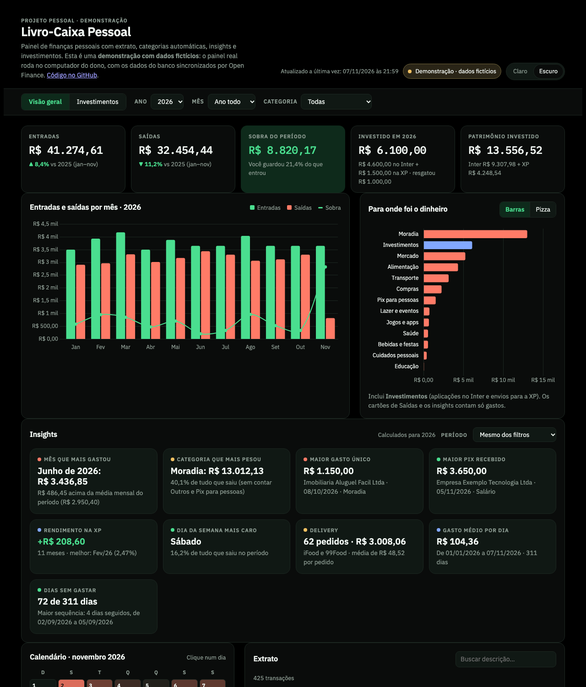
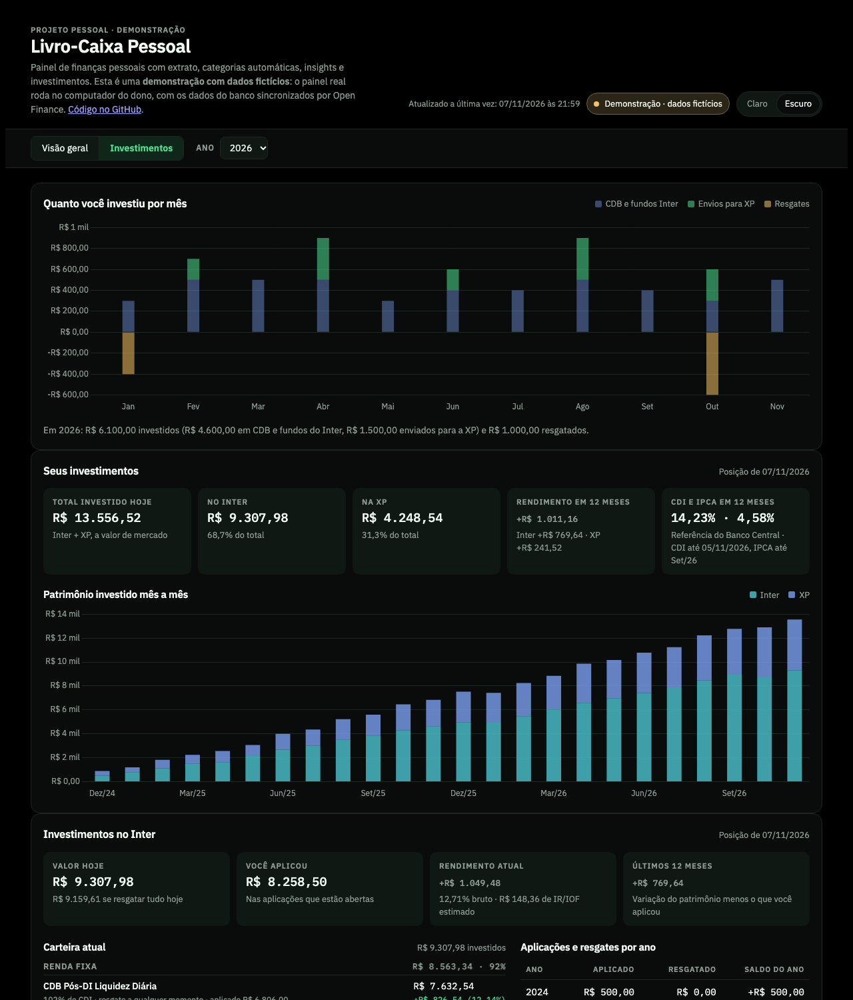
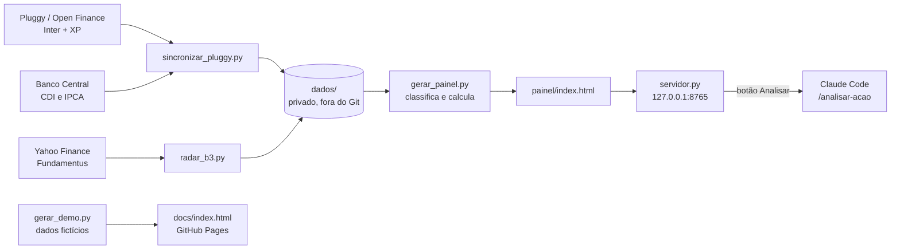

# Meu Painel Financeiro

[](https://github.com/cauaalmeida01/MeuProjetoFinanceiro/actions/workflows/testes.yml)

Painel de finanças pessoais que junta a conta do **Inter** e a corretora **XP** num só lugar. O que ele faz:
- busca o extrato e os investimentos sozinho, via Open Finance;
- categoriza cada gasto;
- gera insights;
- compara a carteira com CDI, IPCA e Ibovespa.

Os dados reais nunca saem do computador do dono; a versão pública usa dados fictícios.

**[▶ Ver a demonstração](https://cauaalmeida01.github.io/MeuProjetoFinanceiro/)** · dados fictícios, mesmo código do painel real

| Visão geral | Investimentos |
|---|---|
|  |  |

## Destaques

- **Sincronização automática por Open Finance**:
  - a [Pluggy](https://pluggy.ai) traz o extrato do Inter e as posições da XP várias vezes ao dia;
  - quando o Mac acorda sem internet, ela espera a rede voltar;
  - quando a API demora, tenta de novo;
  - se um banco falha, o outro é salvo mesmo assim.
- **Categorização por regras:**
  - regras por estabelecimento, versionadas;
  - regras por pessoa, privadas;
  - detecção automática de Pix para pessoa física.
  - Com isso, a fatia de gastos sem categoria ("Outros") caiu de 74,5% para 10%.
- **Conciliação entre bancos:** um Pix do Inter para o próprio CPF só conta como aporte quando o valor aparece na conta da XP. O resto é tratado como transferência entre contas suas.
- **Rentabilidade contra o CDI, recalculada:** com o CDI diário da API do Banco Central, o cálculo bate com o portal da XP: **115,99% contra 116,02%** do CDI desde a abertura.
- **Radar B3:** preço, risco (volatilidade e maior queda), proventos e fundamentos das ações, com dados do Yahoo Finance e do Fundamentus. Mostra os números lado a lado, sem recomendação de compra ou venda.
- **Análise de ações com IA:** um botão roda a skill `/analisar-acao` do Claude Code em segundo plano e devolve um relatório de pesquisa em português.
- **Servidor local seguro:**
  - Python puro, sem dependências;
  - só aceita conexões do próprio computador;
  - CORS restrito a origens locais;
  - checagem de Host contra ataques de DNS rebinding;
  - nomes de arquivo validados contra acesso a outras pastas.

## Arquitetura



**Stack:**
- **Python 3**, só biblioteca padrão.
- **Front-end:** HTML, CSS e JavaScript puros, com gráficos em Chart.js.
- **Agendamento:** launchd (macOS).
- **Dados externos:** APIs da Pluggy, do Banco Central (SGS), do Yahoo Finance, do Fundamentus e da brapi.

**Privacidade como requisito:**
- extrato, nomes de terceiros e chaves ficam em `dados/` e `.env`, os dois no `.gitignore`;
- o repositório só tem código e regras genéricas;
- a demo pública é gerada por `scripts/gerar_demo.py` sem ler nada de `dados/`.

## Estrutura

```
regras_categorias.json      regras por estabelecimento (iFood → Alimentação…)
scripts/gerar_painel.py     classifica o extrato e gera o painel
scripts/importar_extrato.py junta um extrato novo ao histórico
scripts/sincronizar_pluggy.py busca o extrato na Pluggy e gera o painel
scripts/indices_bcb.py       baixa CDI e IPCA do Banco Central
scripts/radar_b3.py          Radar B3: cotações, proventos e fundamentos das suas ações
scripts/servidor.py          abre o painel com os botões (adicionar ação, analisar, sincronizar)
scripts/ligar_painel.sh      deixa o servidor sempre ligado no Mac e cria o app "Painel Financeiro"
scripts/agendar_sincronizacao.sh liga/desliga a sincronização automática no Mac
scripts/gerar_demo.py        gera a demonstração pública (docs/) com dados fictícios
tests/                       testes automatizados (pytest)
.claude/skills/analisar-acao skill /analisar-acao TICKER (relatório de pesquisa em português)
painel/base.html            o painel (HTML + gráficos), sem dados
docs/                       demonstração pública (GitHub Pages)

dados/                      NÃO vai para o GitHub
  inter_extrato.psv         histórico bruto do Inter
  regras_pessoais.json      pessoas → categoria, e seus próprios nomes
  xp.json                   posição, evolução mensal e conciliação da XP
  inter_invest.json         posição e evolução mensal dos investimentos do Inter
  transacoes.json           gerado
painel/index.html           gerado, com seus dados (NÃO vai para o GitHub)
```

## Testes

```bash
python3 -m venv .venv
.venv/bin/pip install pytest ruff
.venv/bin/pytest
.venv/bin/ruff check .
```

São 221 testes, que rodam em cerca de 1 segundo, a cada push, pelo GitHub Actions. Eles cobrem:
- as regras de classificação e a conciliação entre bancos;
- os cálculos contra CDI e IPCA;
- a junção do extrato sem duplicar;
- a sincronização: novas tentativas, falha de um banco, fuso horário;
- a atualização das posições da XP;
- o Radar B3;
- a segurança do servidor: origens de fora, acesso a outras pastas, tickers inválidos;
- a garantia de que a demo não contém dados reais.

Os testes nunca acessam a internet nem a pasta `dados/`: um fixture aponta todos os caminhos para uma pasta temporária e bloqueia a rede.

## Atualizar a demonstração

```bash
python3 scripts/gerar_demo.py
```

O script gera `docs/index.html` a partir de uma pessoa fictícia, a "Ana Exemplo", com 24 meses de extrato. O extrato passa pelo mesmo classificador do painel real. CDI, IPCA e cotações são dados públicos, buscados na hora. Faça commit e push, e o GitHub Pages publica sozinho.

## Painel sempre ligado no Mac

```bash
scripts/ligar_painel.sh            # liga uma vez; depois sobe sozinho ao entrar no Mac
scripts/ligar_painel.sh remover    # desliga
```

O script transforma o `servidor.py` num serviço do macOS, como o agendamento da sincronização:
- ele fica rodando em segundo plano em `http://127.0.0.1:8765`, uma porta acessível só deste Mac;
- se cair, volta sozinho;
- o app **Painel Financeiro**, em `~/Applications`, abre o painel no navegador e pode ir para o Dock.

Não precisa de VS Code nem de terminal aberto. O log fica em `dados/servidor.log`.

## Abrir o painel com os botões

```bash
python3 scripts/servidor.py
```

O comando abre `http://127.0.0.1:8765` no navegador. Para parar, use Ctrl+C. Com o servidor rodando, o painel ganha alguns botões:
- **Sincronizar agora**, no topo;
- **Adicionar ação**, **Analisar**, **Último relatório** e **Remover**, no Radar B3;
- a lista de relatórios, que abrem dentro do próprio painel.

O **Analisar** roda `claude -p "/analisar-acao TICKER"` em segundo plano. Leva alguns minutos e usa a sua conta do Claude Code. Durante a análise, o Claude só tem permissão para rodar o `radar_b3.py`, buscar na web e salvar o relatório. O log fica em `dados/relatorios/.log-TICKER.txt`.

O servidor só aceita conexões do próprio computador. Se você prefere o Go Live (Live Server) do VS Code, os botões também aparecem lá, contanto que o `servidor.py` esteja rodando em outro terminal: o painel procura o servidor na porta 8765. Sem o servidor, o painel mostra uma dica de como ligá-lo. Aberto como arquivo, ele funciona igual, só que sem os botões.

## Gerar o painel

```bash
python3 scripts/gerar_painel.py
```

Depois abra `painel/index.html` no navegador.

## Atualização automática (Pluggy / Open Finance)

Os bancos ficam conectados no [Meu Pluggy](https://meu.pluggy.ai), e a API da Pluggy entrega o extrato dos últimos ~12 meses. Crie um `.env` na raiz (já está no `.gitignore`):

```
PLUGGY_CLIENT_ID=...
PLUGGY_CLIENT_SECRET=...
PLUGGY_ITEM_IDS=id-do-inter,id-da-xp
```

Os Item IDs ficam em dashboard.pluggy.ai, em Demo, no menu ⋮ de cada conexão, opção "Copiar Item ID".

```bash
python3 scripts/sincronizar_pluggy.py          # sincroniza agora
scripts/agendar_sincronizacao.sh               # liga a sincronização (8h, 12h, 15h, 18h e 21h)
scripts/agendar_sincronizacao.sh remover       # desliga
```

O histórico antigo continua em `dados/inter_extrato.psv`; só o período que a Pluggy cobre é substituído. Da XP vêm as posições, o saldo, os proventos e os Pix recebidos do Inter (que entram na conciliação de `envios_inter_para_xp`), gravados em `dados/xp.json`. A cada mês o script guarda o patrimônio da XP em `fotos_mensais` e, a partir de novembro de 2026, calcula aportes e rendimento do mês; a rentabilidade acumulada e o % do CDI são recalculados com o CDI e o IPCA da API pública do Banco Central (`scripts/indices_bcb.py`, salvos em `dados/indices.json`). Encadeando os meses do portal da XP, esse cálculo dá 115,99% do CDI desde a abertura, contra 116,02% do portal. O log, com a data e a hora de cada execução, fica em `dados/sincronizacao.log`. A Pluggy busca os bancos uma vez por dia, então uma compra de hoje normalmente aparece no painel no dia seguinte. A sincronização roda várias vezes ao dia para não perder essa atualização. Ela espera a internet voltar se o Mac acabou de acordar, tenta de novo quando a Pluggy demora e salva um banco mesmo se o outro falhar. A autorização do Open Finance vence em até 12 meses e precisa ser renovada no Meu Pluggy.

## Radar B3 e /analisar-acao

O Radar B3 mostra, para as ações da sua carteira na XP e as que você acompanha:
- preço e retorno em 1, 3 e 12 meses comparados ao Ibovespa e ao CDI;
- distância da máxima do ano, volatilidade e maior queda;
- dividend yield de 12 meses;
- P/L, P/VP, ROE, margem e dívida/patrimônio.

Ele é atualizado em cada sincronização. Não é recomendação de compra ou venda.

```bash
python3 scripts/radar_b3.py --adicionar WEGE3 VALE3   # acompanhar
python3 scripts/radar_b3.py --remover WEGE3           # parar de acompanhar
python3 scripts/radar_b3.py                           # atualizar agora
```

As cotações e os proventos vêm do Yahoo Finance. Os indicadores (P/L, P/VP, ROE, margem e dívida líquida) vêm do [Fundamentus](https://www.fundamentus.com.br). Nenhum dos dois precisa de chave. Da [brapi.dev](https://brapi.dev) vêm o setor e a descrição da empresa, com o `BRAPI_TOKEN` no `.env`. O plano grátis dela não libera os indicadores.

Com o Claude Code aberto nesta pasta, `/analisar-acao PETR4` monta um relatório de pesquisa em `dados/relatorios/`, com números, comparação com o setor, notícias, pontos a favor e contra e riscos. Não traz veredito de compra ou venda.

## Atualizar à mão

1. Pegue o extrato do período novo no formato `data|titulo|descricao|valor|tipo`.
2. `python3 scripts/importar_extrato.py caminho/do/novo.psv`. Ele substitui tudo a partir da primeira data do arquivo novo, então repetir um período não duplica nada.
3. `python3 scripts/gerar_painel.py`

## Categorias

- Estabelecimentos: `regras_categorias.json`. A primeira regra que bater vence.
- Pessoas: `dados/regras_pessoais.json`. Em `destinos` ficam os Pix enviados (amigos, família, faxina…) e em `origens`, os recebidos (ex.: família). Essas regras têm prioridade.
- Pix para pessoas físicas que nenhuma regra reconhece vão para **Pix para pessoas**. O resto que nada reconhece vai para **Outros**. Aplicações e resgates contam como investimento, e Pix entre contas suas não conta como gasto.
